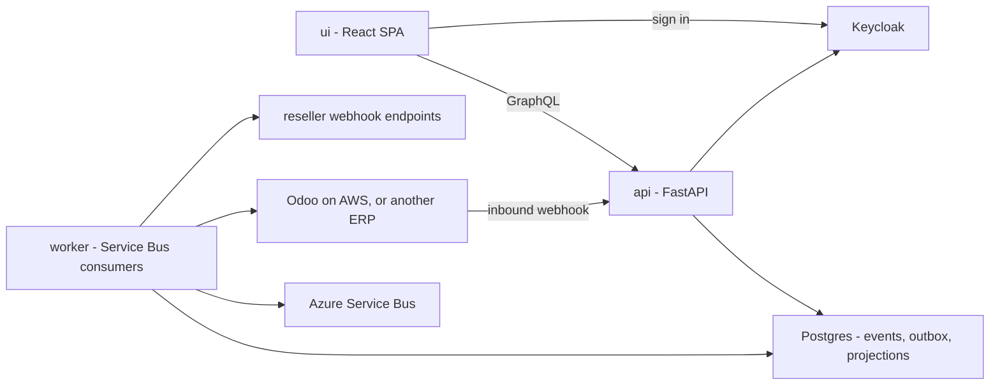

# AdminOps

AdminOps reads a reseller order from the ERP on the quote's subsidiary (Odoo today; see
`docs/adding-an-erp.md` for adding more). Orders are event-sourced, asynchronous work runs
through a transactional outbox and Azure Service Bus, and the GraphQL API is split by
audience (reseller vs. operator) so ERP identity never reaches a reseller.

Start with `docs/database-schema.md` (every table), `docs/event-sourcing-explained.md` (why
events instead of just updating rows), and `docs/architecture-guide.md` (the moving parts).

## Architecture

It's a modular monolith. Every bounded context in `src/modules/` runs inside the same two
Python processes, `api` and `worker`, sharing one Postgres database. Modules call each other
through ports (interfaces), not network calls. The only process boundary is `api` ↔
`worker`, and it's asynchronous: they talk through the outbox and Service Bus.

| Process / service | What it does | Talks to |
|---|---|---|
| **`api`** (FastAPI) | Serves GraphQL (`/graphql/reseller`, `/graphql/operator`) and inbound ERP webhooks. Handles reads and synchronous writes. | Postgres, Keycloak (auth) |
| **`worker`** | Service Bus consumers (order-processing, order-delivery, order-fulfillment, projections, webhook-dispatch), the outbox relay, the reconciliation sweeper, and the mapping role that runs ERP field-mapping jobs through an LLM. | Postgres, Service Bus, the ERP, reseller webhook endpoints, the LLM |
| **`ui`** (React SPA) | AdminOps. Talks to `api` over GraphQL only. | `api`, Keycloak |



**One database, two kinds of data.** Aggregates (`Order`, `Shipment`, `Invoice`) are
written as events. Everything else (connections, bindings, quotes) is plain CRUD rows.

## Deployment

- **Azure** runs the portal: Container Apps (api, worker, Keycloak, mocks, agent), Service
  Bus, Key Vault, Postgres, Front Door, and the UI on a storage static website. Terraform is
  in `infra/azure/`. See `docs/deploy-azure.md`.
- **AWS** runs Odoo (`infra/aws-odoo-poc/`) and, optionally, Bedrock for the mapping LLM.

## Tech stack

**Backend**: Python 3.11 · FastAPI + Strawberry GraphQL · SQLAlchemy + PostgreSQL · Azure
SDKs for Service Bus and Key Vault · Alembic · pytest + Hypothesis.

**Frontend** (`ui/`): React 18 + TypeScript + Vite · TanStack Query · a hand-rolled GraphQL
client and Keycloak sign-in (no SDKs) · plain CSS on a small design-token system. Builds to
static files; no Node server in production.

## Project layout

```
src/
  api/               # FastAPI app: GraphQL (reseller + operator), HTTP webhooks, health
  worker/            # Service Bus consumers, outbox relay, reconciliation scheduler
  composition.py     # the one place the object graph is wired (memory | postgres profile)
  modules/           # sales/ (ordering, quoting, shipment, invoicing),
                     # reference/ (connections, tenancy),
                     # integration/ (ERP adapters, webhooks_inbound, webhooks_outbound, mapping)
                     # each has domain/ (pure), application/ (ports + services),
                     # infrastructure/ (memory + postgres adapters), tests/ (co-located)
  shared/            # eventsourcing kernel, messaging, persistence, secrets, identity, config
ui/                  # React SPA (AdminOps)
migrations/          # Alembic
tests/e2e/           # full in-memory flow (place order -> deliver -> webhook -> projection)
tests/integration/   # against a real Postgres (self-skips if unreachable)
scripts/             # local.sh, seed_demo.py, odoo-boot.sh, dev_webhook_receiver.py,
                     # mock_netsuite.py, deploy_azure.sh
docs/                # guides, ERP notes (erps/<erp>/), ADRs (adr/)
infra/azure/         # Terraform for the Azure stack
infra/aws-odoo-poc/  # Terraform for Odoo on AWS
```

## Run locally

One-time setup, from the repo root:

```bash
python -m venv .venv
. .venv/Scripts/activate          # Windows Git Bash; source .venv/bin/activate on macOS/Linux
pip install -e ".[dev]"
cd ui && npm install && cd ..
```

Then:

```bash
bash scripts/local.sh up          # Docker (Odoo, Keycloak), api, seed, mocks, AdminOps, coding agent
bash scripts/local.sh down        # stop those processes and containers
```

Local runs the **memory profile**: the api holds state in process memory and runs the order
pipeline synchronously through the in-memory bus, so no broker is needed. The worker and
Postgres are not used locally, and state resets whenever `up` restarts the api, which then
reseeds. The first Odoo boot installs modules and takes a few minutes.

Sign in to AdminOps as `operator1` / `operator1`. Odoo is `admin` / `admin`, and Keycloak's
admin console is `admin` / `admin`. The seed creates a reseller ("Acme Retail"), a product
catalog, and a confirmed order (PO reference `PO-48213`) in Odoo, and connects it to the
demo tenant. It also registers the NetSuite connection and the reseller webhook endpoint.

Odoo may show a sticky banner, "Registration failed - push service not available". That is
the browser refusing desktop notifications on this local site. Dismiss it.

| What | URL |
|---|---|
| AdminOps | http://127.0.0.1:5173 |
| API liveness | http://127.0.0.1:8000/livez |
| Reseller GraphQL | http://127.0.0.1:8000/graphql/reseller |
| Operator GraphQL | http://127.0.0.1:8000/graphql/operator |
| Keycloak | http://localhost:8080 |
| Odoo | http://localhost:8069 |
| Reseller mock | http://127.0.0.1:8090/hooks |
| NetSuite (SuiteTalk REST) | http://127.0.0.1:8075 |
| NetSuite triggers (Swagger) | http://127.0.0.1:8075/docs |
| Adapter agent | http://127.0.0.1:8002/livez |

Logs are in `.local/`. The seed writes the reseller's signing secret to
`.local/reseller-secret`, and the reseller mock reads it on start.

## Adding a new ERP

`docs/adding-an-erp.md` covers the four touch points: a status mapper, an adapter, one
registry line, and one enum member. `docs/erps/<erp>/` holds that ERP's adapter notes,
inbound webhook, and supply-chain check.

## Run tests

Backend:

```bash
pip install -e ".[dev]"
pytest src tests
```

`src/*/tests/` and `tests/e2e/` are database-free. `tests/integration/` needs a Postgres
(`docker compose up -d postgres`) and self-skips with a clear reason if it isn't reachable.

Frontend:

```bash
cd ui
npm run build      # tsc --noEmit && vite build
```
