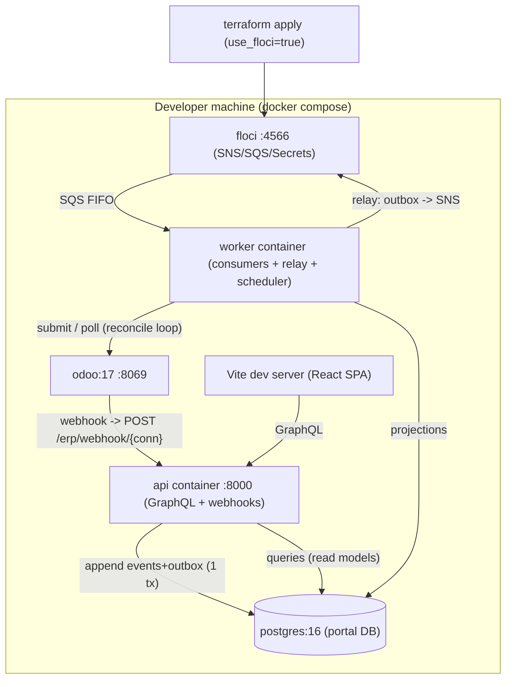
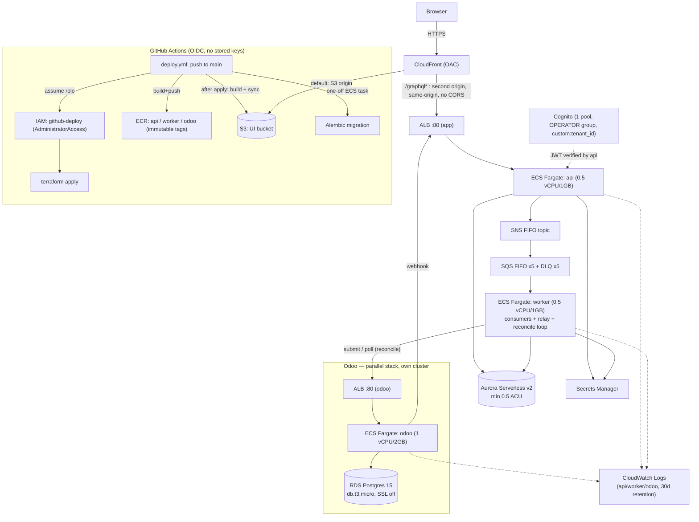

# Deployment Architecture — Target Architecture (Phase 3)

## Local (floci) — the full async E2E you can run on a laptop

Bring-up: `docker compose up -d` → `terraform -chdir=infra/terraform apply -var-file=envs/local.tfvars` → `alembic upgrade head` → seed demo data → api+worker+Odoo containers start → `npm run dev` (UI) → configure Odoo Automation Rule.

## AWS (staging) — as actually built, two parallel stacks + CI/CD

Provisioned by Terraform (`use_floci=false`, `envs/staging.tfvars`): VPC + **public**
subnets (no NAT yet), 1 Aurora cluster (portal), 1 RDS instance (Odoo), 2 ECS clusters
(`o2c-staging`, `o2c-staging-odoo`), 2 ALBs, 1 Cognito pool + app client, SNS/SQS, Secrets
Manager, IAM task + CI roles, 3 ECR repos, CloudWatch log groups, S3 + CloudFront for the
UI. First apply must run from a human's own AWS credentials (OIDC bootstrap chicken-and-
egg); every push to `main` after that deploys itself via `deploy.yml`.

## Parity: what changes local → AWS
| Concern | Local (floci) | AWS (staging) |
|---|---|---|
| Messaging | floci SNS/SQS via `AWS_ENDPOINT_URL` | real SNS/SQS |
| Secrets | floci Secrets Manager | Secrets Manager |
| Portal DB | `postgres:16` container | Aurora Serverless v2 |
| Odoo DB | `odoo:17`'s own bundled Postgres | RDS Postgres 15 (separate instance) |
| Compute | api/worker/odoo containers | ECS Fargate (3 services, 2 clusters) |
| Ingress | api :8000 / odoo :8069 direct | 2 ALBs; UI through CloudFront, `/graphql*` proxied to the api ALB |
| UI | Vite dev server | S3 (private) + CloudFront (OAC) |
| Identity | JWT/header stub | Cognito (1 pool) |
| Scheduler | worker's in-process loop | same loop, inside the Fargate task (not EventBridge) |
| CI/CD | n/a — run commands by hand | GitHub Actions over OIDC, auto on push to `main` |
| Provisioning | `terraform … envs/local.tfvars` | `terraform … envs/staging.tfvars` (+ one-time bootstrap) |

Only endpoints + credentials + the AWS-only module toggle differ — application code is
identical (ports + `AWS_ENDPOINT_URL`). Odoo is the one piece that isn't 1:1 parity by
design: locally it's a single container with its own embedded Postgres; on AWS it's a
dedicated Fargate service talking to a dedicated RDS instance, isolated from the portal's
Aurora on purpose (see infrastructure-design.md's "Odoo: a parallel stack").
