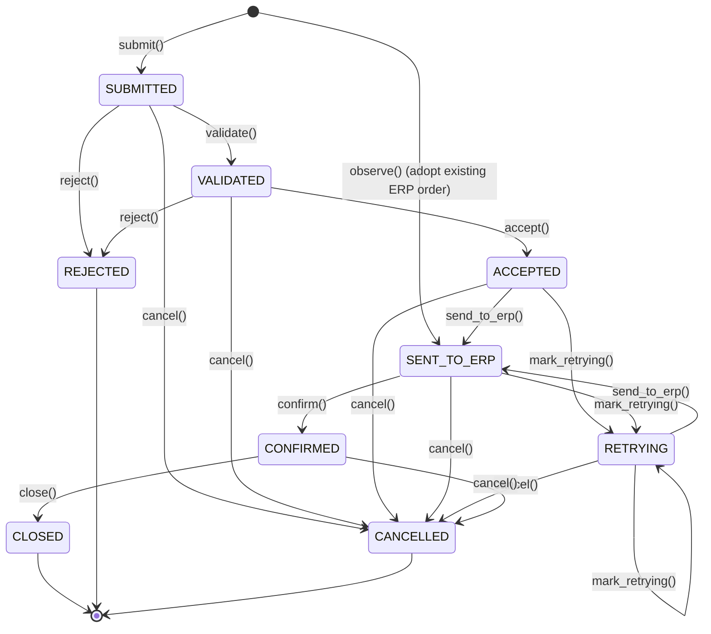
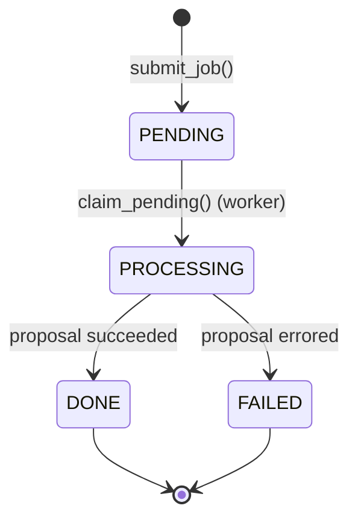
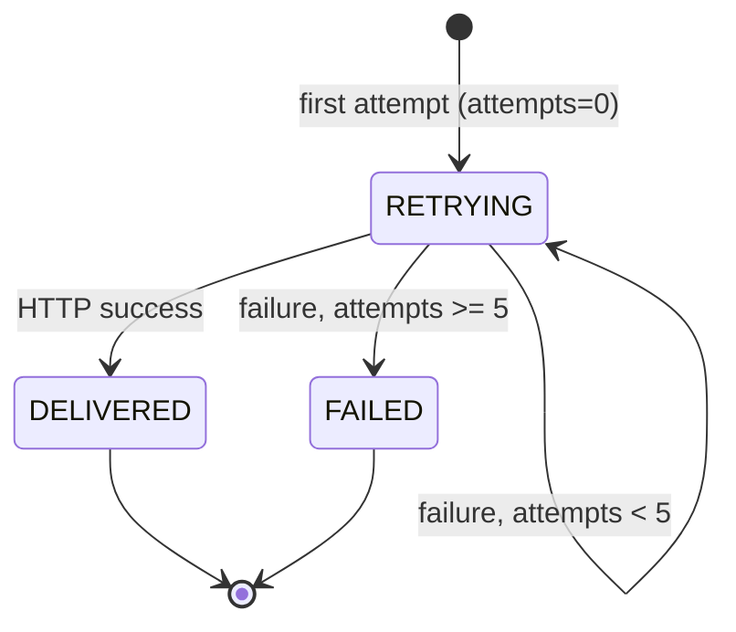

# State machines and lifecycle statuses

This page documents every stateful lifecycle in the codebase, verified against the source.
It is a *description of the code as it stands*, not a specification — if the two ever
disagree, the code wins and this page is the bug.

A note on terms, because they are easy to conflate:

- **Event-sourced aggregate** — stored as a stream of events, rebuilt by replay. There are
  three: `Order`, `Shipment`, `Invoice`. Being event-sourced does **not** imply a
  multi-state lifecycle: only `Order` has one. `Shipment` and `Invoice` are record-only
  (one command, one event, no transitions).
- **State machine** — an entity with named states and guarded transitions between them.
  `Order` is the only aggregate that is one. Several non-event-sourced ("CRUD") entities
  also carry a status enum with a small set of transitions; those are documented too.

There is **no** `Payment`, `Return`, or `PurchaseOrder` aggregate in the code. (Earlier
process notes in `aidlc-docs/` mention a `fulfillment` module with `Payment`/`Return`; that
is not what shipped — the module was split into the record-only `Shipment` and `Invoice`
aggregates below.)

| Entity | Kind | Has a real state machine? | Section |
|---|---|---|---|
| `Order` | Event-sourced aggregate | Yes | [Order lifecycle](#order-lifecycle) |
| `Shipment` | Event-sourced aggregate | No (record-only) | [Record-only aggregates](#record-only-event-sourced-aggregates) |
| `Invoice` | Event-sourced aggregate | No (record-only) | [Record-only aggregates](#record-only-event-sourced-aggregates) |
| `Quote` | CRUD entity | Partial (see note) | [Quote](#quote-quotestatus) |
| `MappingJob` | CRUD entity | Yes | [Mapping job](#mapping-job-mappingstatus) |
| `ErpConnection` | CRUD entity | Yes (toggle) | [Connection](#connection-connectionstatus) |
| `TenantConnectionBinding` | CRUD entity | Yes | [Binding](#binding-bindingstatus) |
| `WebhookDelivery` | CRUD entity | Yes | [Outbound webhook delivery](#outbound-webhook-delivery-deliverystatus) |

---

## Order lifecycle

The one multi-state, event-sourced aggregate. State changes only by applying events; each
public command guards the current state and, on success, emits one fact. A guard failure
raises `OrderInvalidTransition`.

Source: [`domain/aggregate.py`](../src/modules/sales/ordering/domain/aggregate.py),
[`domain/models.py`](../src/modules/sales/ordering/domain/models.py) (`OrderState`,
`TERMINAL_STATES`). Rationale: [ADR-0014](adr/0014-orthogonal-fulfillment-invoice-status.md).

### States

| State | Meaning | Terminal |
|---|---|---|
| `SUBMITTED` | Reseller placed the order; owning connection already decided (from the quote), binding not yet confirmed. Initial state for the normal path. | No |
| `VALIDATED` | The tenant's binding to the owning connection is confirmed verified. | No |
| `ACCEPTED` | Routed and ready to send to the ERP. (Renamed from `READY_FOR_DELIVERY` in Increment 5.) | No |
| `SENT_TO_ERP` | Handed to the ERP; an `erp_order_id` is known. Also the initial state for an adopted order (`observe()`). | No |
| `RETRYING` | A send attempt failed and is scheduled to retry; carries `retry_attempt`. | No |
| `CONFIRMED` | The ERP confirmed the order. Fulfillment/invoice recording is allowed from here. | No |
| `CLOSED` | Complete. | **Yes** |
| `REJECTED` | Rejected before going live; carries a reason code and reseller-facing message. | **Yes** |
| `CANCELLED` | Cancelled by the operator, or because the ERP reported it cancelled. | **Yes** |

`TERMINAL_STATES = {CLOSED, CANCELLED, REJECTED}`. There is no `FULFILLED` state — it was
removed in Increment 5 (FR-A6); "fully shipped/delivered" is an orthogonal score, not a
lifecycle step.

### Transitions

| Command | From | To | Event | Notes |
|---|---|---|---|---|
| `submit(...)` | *(none)* | `SUBMITTED` | `OrderSubmitted` | Factory. Requires ≥1 line; each line needs `product_key`, `line_id`, positive quantity. |
| `observe(...)` | *(none)* | `SENT_TO_ERP` | `OrderObserved` | Factory. Adopts an order already in the ERP; does **not** emit `OrderReadyForDelivery`. |
| `validate()` | `SUBMITTED` | `VALIDATED` | `OrderValidated` | |
| `accept()` | `VALIDATED` | `ACCEPTED` | `OrderReadyForDelivery` | Requires an owning connection. |
| `reject(code, msg)` | `SUBMITTED`, `VALIDATED` | `REJECTED` | `OrderRejected` | Only before going live. |
| `send_to_erp(erp_order_id)` | `ACCEPTED`, `RETRYING` | `SENT_TO_ERP` | `OrderSentToErp` | |
| `mark_retrying(attempt, next_retry_at)` | `ACCEPTED`, `RETRYING`, `SENT_TO_ERP` | `RETRYING` | `OrderRetrying` | |
| `confirm()` | `SENT_TO_ERP` | `CONFIRMED` | `OrderConfirmed` | Idempotent: no-op if already `CONFIRMED`. |
| `close()` | `CONFIRMED` | `CLOSED` | `OrderClosed` | Idempotent: no-op if already `CLOSED`. |
| `cancel(reason)` | any non-terminal | `CANCELLED` | `OrderCancelled` | Blocked only from terminal states. |

Commands that are allowed but leave `OrderState` unchanged (they update the orthogonal maps
below): `record_fulfillment(...)` and `record_invoice(...)` (allowed in `CONFIRMED` or
`CLOSED`), and `set_vendor_date(...)` (allowed in any state except `None`, `SUBMITTED`,
`REJECTED`, `CANCELLED`).

### Orthogonal status dimensions

Partial fulfillment ("3 of 5 units shipped") does not fit a linear lifecycle, so three
dimensions live *beside* `OrderState`, each **derived** from per-line quantity maps, not
stored as a state (ADR-0014):

| Dimension | Derived from | Values |
|---|---|---|
| `FulfillmentStatus` | `shipped_qty_by_line` vs ordered | `UNFULFILLED` → `PARTIALLY_FULFILLED` → `FULFILLED` |
| `DeliveryStatus` (ordering) | `delivered_qty_by_line` vs ordered | `NOT_DELIVERED` → `PARTIALLY_DELIVERED` → `DELIVERED` |
| `InvoiceStatus` | `invoiced_qty_by_line` vs ordered | `NOT_INVOICED` → `PARTIALLY_INVOICED` → `INVOICED` |

Rule for all three: every ordered line recorded ≥ ordered → full; some but not all →
partial; otherwise → none. Shipped vs delivered differ by line kind (`line_is_delivered`,
FR-D2): a `LICENSE` line is delivered the moment it ships; a `PHYSICAL` line only once a
carrier or proof-of-delivery is recorded.

### How the ERP drives the lifecycle

Inbound webhooks and the reconcile sweeper don't call commands directly. They map a native
ERP status into a `CanonicalStatus` (`CONFIRMED`, `CLOSED`, `CANCELLED` —
[`shared/canonical_status.py`](../src/shared/canonical_status.py)) and hand it to
`StatusApplier` ([`application/adapters.py`](../src/modules/sales/ordering/application/adapters.py)),
which:

- for `CANCELLED`, calls `cancel()`;
- otherwise walks the ordered progression `CONFIRMED → CLOSED`, applying every step up to
  the reported status (so a jump straight to `CLOSED` also applies `confirm()`);
- suppresses `OrderInvalidTransition` throughout — the lifecycle is monotonic, so a stale
  or out-of-order update that no longer applies is simply ignored.

`CanonicalStatus` deliberately has no `FULFILLED` member.

### Replay / legacy notes

- `OrderFulfilled` applies as a no-op (the `FULFILLED` state left the lifecycle in
  Increment 5) so pre-Increment-5 streams still rebuild.
- On snapshot restore, a legacy `READY_FOR_DELIVERY` maps to `ACCEPTED`, and a legacy
  `FULFILLED` maps to `CONFIRMED`.

---

## Record-only event-sourced aggregates

`Shipment` ([`sales/shipment`](../src/modules/sales/shipment/domain/aggregate.py)) and
`Invoice` ([`sales/invoicing`](../src/modules/sales/invoicing/domain/aggregate.py)) are
event-sourced but have **no lifecycle**: each has a single factory command (`record(...)`)
that emits a single event (`ShipmentRecorded` / `InvoiceRecorded`), and no further
transitions. They exist as aggregates so each dispatch/invoicing fact is an immutable,
independently-addressable record carrying its own `order_id` — not to model a process.

They feed the Order's orthogonal fulfillment/invoice dimensions above; they do not have
states of their own.

---

## CRUD entity lifecycles

These are plain records (not event-sourced). Their "state machine" is a status enum plus
the application-service methods that reassign it. Transitions listed below are exactly the
ones the code performs.

### Quote (`QuoteStatus`)

Source: [`quoting/domain/models.py`](../src/modules/sales/quoting/domain/models.py),
[`quoting/application/service.py`](../src/modules/sales/quoting/application/service.py).

Declared statuses: `DRAFT`, `ISSUED`, `EXPIRED`, `ACCEPTED`. **Important precision:** in the
current code only two transitions actually happen —

- `issue_quote(...)` creates a quote **directly as `ISSUED`** (not `DRAFT` then issued);
- `mark_accepted(...)` sets `ISSUED → ACCEPTED` (idempotent; no-op if already `ACCEPTED`).

`DRAFT` is only the dataclass default and is never assigned by any flow. `EXPIRED` is never
assigned either — expiry is evaluated on read by `is_valid_on()` against the validity
window (`valid_from`/`valid_until`), not stored as a status. Only an `ISSUED` quote inside
its window can price a new order.

### Mapping job (`MappingStatus`)

Source: [`mapping/domain/models.py`](../src/modules/integration/mapping/domain/models.py),
[`application/service.py`](../src/modules/integration/mapping/application/service.py),
[`application/processing.py`](../src/modules/integration/mapping/application/processing.py),
repositories in `infrastructure/`.

| Status | Set by | Meaning |
|---|---|---|
| `PENDING` | `submit_job()` | Enqueued, not yet claimed. |
| `PROCESSING` | `claim_pending()` (memory + Postgres repos) | Claimed by the worker, LLM call in flight. |
| `DONE` | `processing` on success | A mapping was proposed (possibly empty). Terminal. |
| `FAILED` | `processing` on any exception | The LLM call errored. Terminal. |

`is_terminal` is `DONE` or `FAILED`. There is no retry transition back to `PENDING` in code.

### Connection (`ConnectionStatus`)

Source: [`connections/domain/models.py`](../src/modules/reference/connections/domain/models.py),
[`application/service.py`](../src/modules/reference/connections/application/service.py).

A two-state toggle: created `ACTIVE`; `pause()` → `PAUSED` (publishes `CONNECTION_PAUSED`);
`resume()` → `ACTIVE` (publishes `CONNECTION_RESUMED`). No terminal/removed state. Only
`ACTIVE` connections are returned by the "active connections" query the sweeper uses.

### Binding (`BindingStatus`)

Source: [`tenancy/domain/models.py`](../src/modules/reference/tenancy/domain/models.py),
[`application/service.py`](../src/modules/reference/tenancy/application/service.py).

Created `TO_VERIFY`; `verify()` → `VERIFIED` (publishes `BINDING_VERIFIED`); `remove()` →
`REMOVED` (publishes `BINDING_REMOVED`). `REMOVED` is terminal. Both `verify()` and
`remove()` set their target state unconditionally from whatever the current one is (no
guard beyond the binding existing). An order only validates against a `VERIFIED` binding.

### Outbound webhook delivery (`DeliveryStatus`)

Source: [`webhooks_outbound/domain/models.py`](../src/modules/integration/webhooks_outbound/domain/models.py),
[`application/dispatch.py`](../src/modules/integration/webhooks_outbound/application/dispatch.py).

One `WebhookDelivery` row per (endpoint, event), updated in place across retries.

| Status | When | Terminal |
|---|---|---|
| `RETRYING` | Initial, and after any failed attempt below the cap. | No |
| `DELIVERED` | An attempt returned success. | Yes |
| `FAILED` | Attempts reached `MAX_ATTEMPTS` (5, mirroring the Service Bus max delivery count). | Yes |

Note: this `DeliveryStatus` (webhook delivery) is a different enum from the ordering
`DeliveryStatus` (goods delivered to the end customer) — same name, unrelated meaning.
